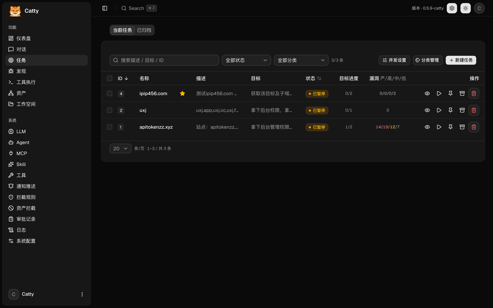
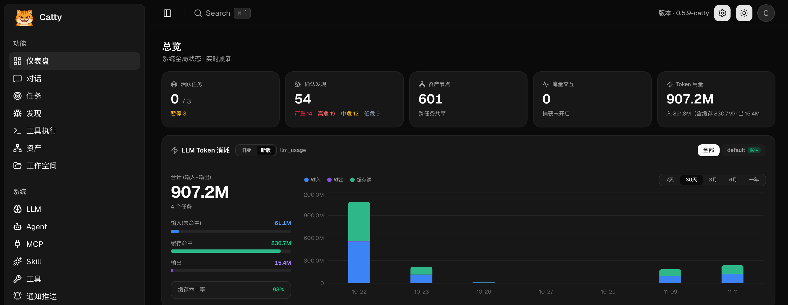
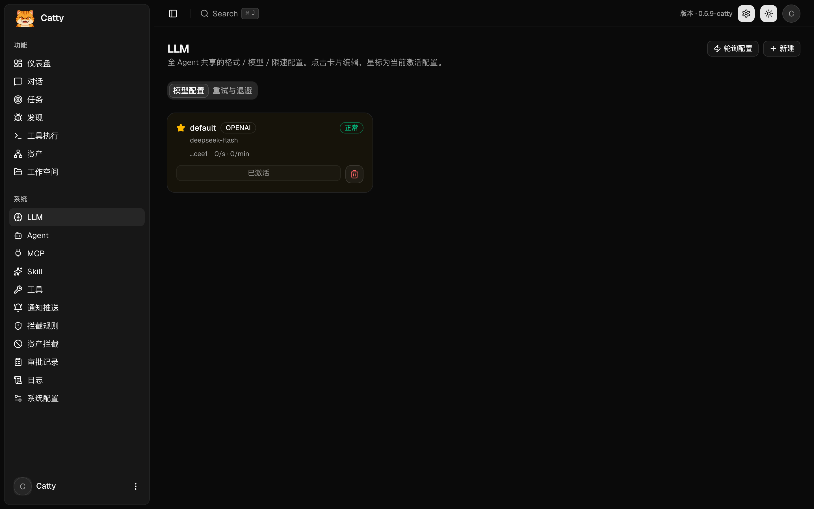
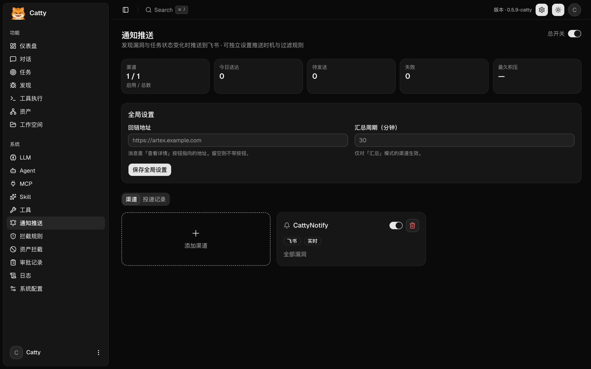

<div align="center">

# Catty

**自主渗透测试控制台** · 七猫内部使用

多 Agent 协作（规划 + 工蜂）、资产图与探索图双图驱动、人在环路审批、全量流量留痕。

</div>

> **使用前提**：Catty 只允许在**已获授权**的范围内使用。开测前必须配置飞书推送，
> 所有任务状态与漏洞结论都会推送到飞书留痕。详见文末「合规与许可」。
>
> 代码仓库：`https://codeup.aliyun.com/qimao/qaarm/comic-drama/Catty`

---

## 截图

| 登录 | 仪表盘 |
| :---: | :---: |
|  |  |

| LLM 配置 | 通知推送 |
| :---: | :---: |
|  |  |

---

## 与上游 ARTEX 的差异

Catty 基于 ARTEX（AGPL-3.0）二次开发，面向内部使用做了以下调整：

| 类别 | 改动 |
| --- | --- |
| 品牌 | 产品名、标题、登录页、侧边栏、图标、启动横幅、健康检查均为 Catty；登录名 `Catty`（兼容旧名 `ARTEX`） |
| 通知 | **仅保留飞书**渠道；测试消息、任务创建/暂停/继续/完成均会推送 |
| 开测闸门 | 未配置「启用且填了 Webhook」的飞书渠道时，**不允许创建任务**（服务端强制） |
| 任务表单 | 目标框预填默认目标；描述尾部自动追加范围约束（含"不包含运行本系统的机器"） |
| 默认值 | 暗色主题；联网搜索默认开启；操作约束注入默认开启；新建 LLM 配置预填中转站参数、上下文 256K |
| 入口精简 | 隐藏「流量」「LLM 录制」「资产同步」「版本与更新」「流量捕获」入口（页面与接口保留） |
| 更新源 | 自更新指向本仓库，避免被上游产物覆盖 |
| 安全 | 抽屉不响应"点外部关闭"（下拉展开时尤其容易误触丢内容）；表单禁用浏览器自动填充 |

---

## 快速开始

### 依赖

- Go **1.26+**、Node **20+**、PostgreSQL **16/17**
- 运行期还需要 `nmap`、`curl`、`rg` 等常用工具

### 1. 数据库

```bash
createdb catty
psql -c "CREATE ROLE catty LOGIN PASSWORD '<密码>'"
```

### 2. 构建

```bash
git clone https://codeup.aliyun.com/qimao/qaarm/comic-drama/Catty
cd Catty

# 前端静态产物
( cd web && npm ci && npm run build:static )

# 拷入内嵌目录后编译单二进制（-tags embedui 才会把前端打进去）
rm -rf server/webui/dist && cp -r web/out server/webui/dist
CGO_ENABLED=0 go build -tags embedui -trimpath -o catty ./cmd/catty
```

### 3. 配置并启动

```bash
cp config.example.json config.json   # 填 database 连接
./start.sh                            # → http://localhost:8787
```

首次访问进入 `/setup` 设置管理员密码。之后登录用户名固定为 `Catty`。

### Docker（从源码构建）

仓库自带的 `Dockerfile` 是「拷贝预编译二进制」的方式，**不要直接使用外部镜像**。
推荐用从源码构建的版本：

```bash
docker build -f Dockerfile.fromsource -t catty:local .
docker compose -f docker-compose.safe.yml up -d
```

`docker-compose.safe.yml` 与官方 compose 的差别：镜像改为本地构建、8787 只绑定 `127.0.0.1`。

---

## 配置

`config.json` 只承载数据库连接与 skill 目录，其余配置在界面里：

| 配置项 | 位置 | 说明 |
| --- | --- | --- |
| 数据库 | `config.json` 或 `ARTEX_PG_DSN` | 启动时自动迁移，无需手工执行 SQL |
| LLM | 系统 → LLM | 新建时预填中转站地址；**必须填 API Key** |
| 通知 | 系统 → 通知推送 | 仅飞书；未配置则无法创建任务 |
| 联网搜索 | 系统配置 | 默认开启（ddgs），会把模型生成的搜索词发到公网 |
| 操作约束注入 | 系统配置 | 默认开启，planner/worker 都会带上约束 |

端口：`8787` 控制台与 API，`8788` 流量录制代理（仅回环）。

---

## 目录结构

```
cmd/catty/        入口（-addr / -proxy / -data）
agent/            规划器、工蜂、主 Agent、提示词与上下文装配
server/           HTTP API、任务引擎、通知投递、审批与拦截
db/               PostgreSQL 访问层与 schema
traffic/          流量录制（MITM 代理）
notify/           飞书等渠道实现与消息渲染
skills/           Agent 可调用的技能（api-recon / playwright-cli / scopesentry）
web/              Next.js 前端（静态导出后内嵌进二进制）
screenshots/      README 配图
```

---

## 架构简述

- **双图**：探索图（意图、事实、漏洞，按任务隔离）+ 资产图（跨任务共享）。
- **引擎**：planner 每轮把态势压成提示词 → 产出意图 → 3 个 worker 并行领取执行 →
  事实与漏洞写回 → 触发下一轮规划。同一轮内的 worker 通过过程级信息交换避免重复劳动。
- **工具面**：Bash / WebFetch / 流量检索 / 自定义工具 / MCP，均在任务工作目录内执行。
- **审批**：工具调用可被拦截规则拦下，等待人工放行；规则与审批记录都在系统设置里。

更多上游设计细节见 [`README.upstream.md`](README.upstream.md)。

---

## 合规与许可

- 许可证：**GNU Affero General Public License v3.0**，全文见 [`LICENSE`](LICENSE)，未修改。
- 本仓库包含对 ARTEX 的修改，修改声明见 [`NOTICE`](NOTICE)（AGPL-3.0 第 5 条）。
- 内部自用通常不触发分发义务；若以网络服务形式提供给公司外部人员使用，
  或对外分发二进制，须按 AGPL 第 13 条提供对应完整源码。

**使用红线**（登录页弹窗同款）：

> 请遵守《中华人民共和国网络安全法》及七猫文化传媒公司安全规定：
> - 严禁对公司和互联网上任何资产，进行任何形式的未授权测试！
> - 严禁对测试目标执行破坏性操作，无论测试/生产环境！
> - 严禁测试期间无人值守，盲目扩大未知测试范围！

Catty 会以运行它的账号身份执行模型编写的命令。**建议在容器或独立低权限账号下运行**，
不要把含有生产凭据的环境变量暴露给它，也不要把本机当作测试目标。
